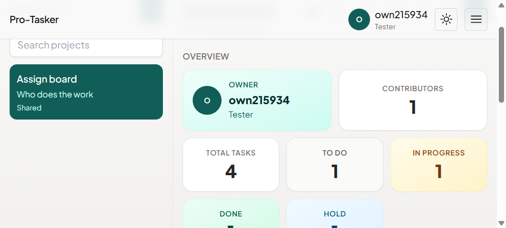
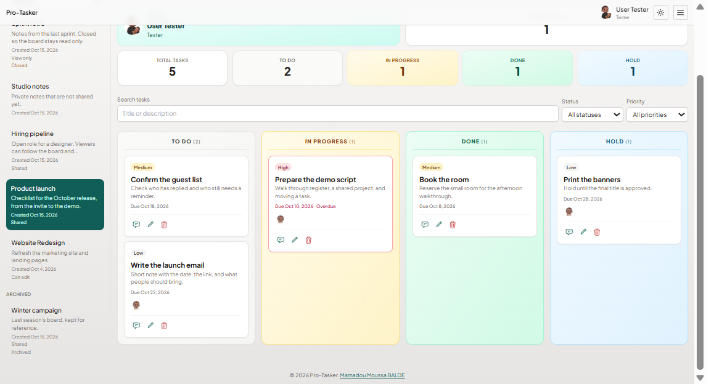
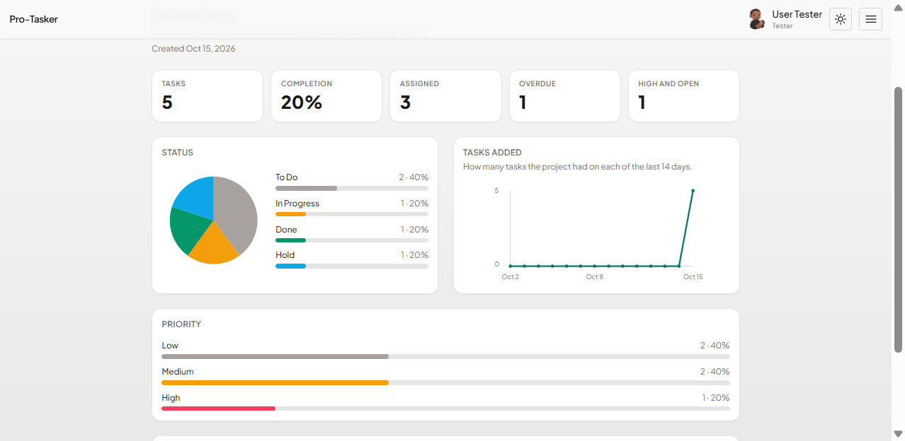
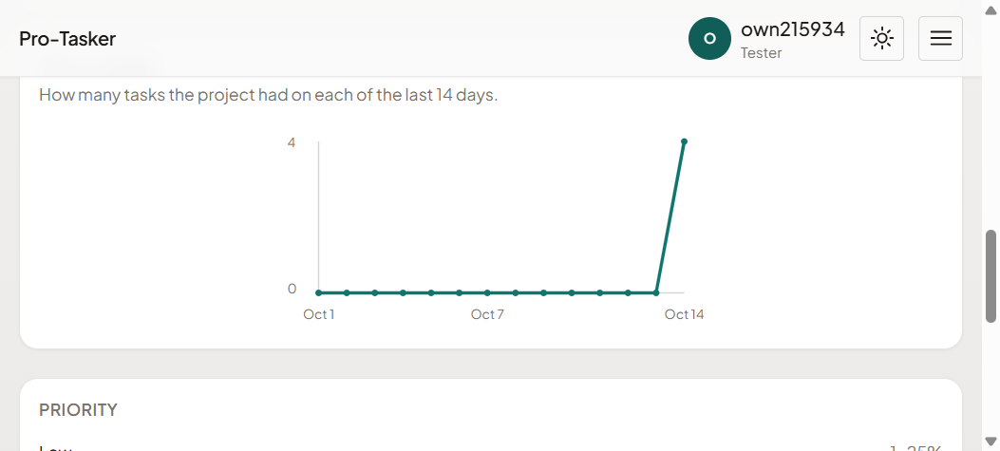
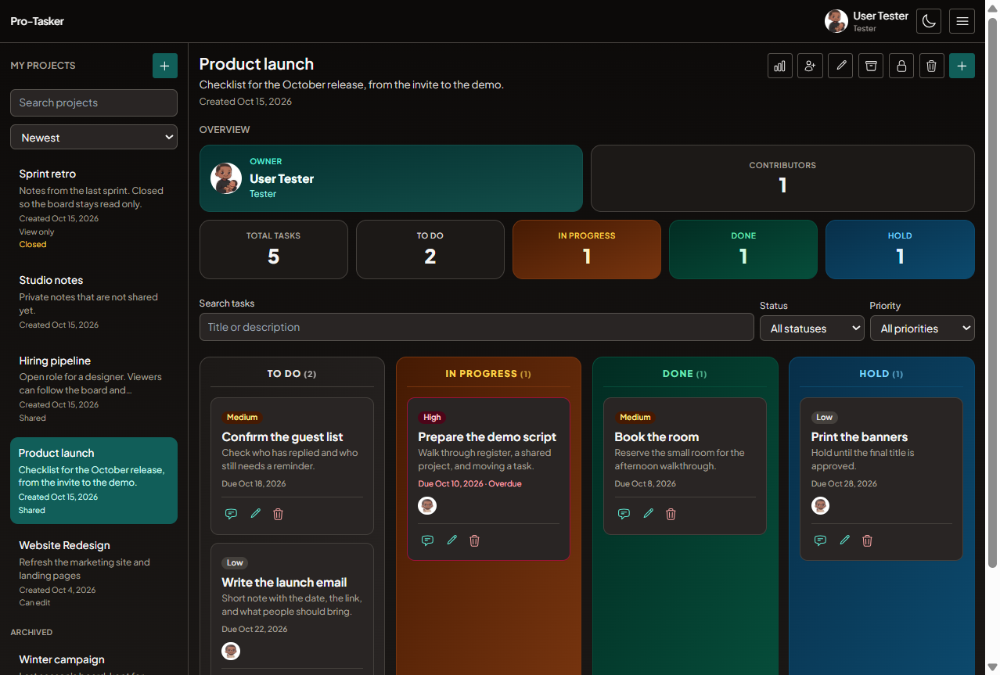
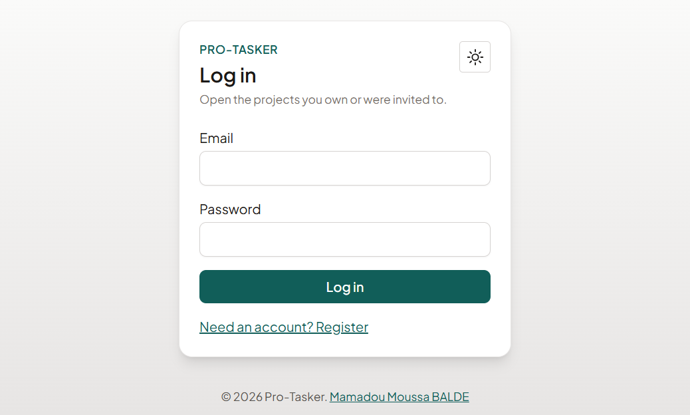
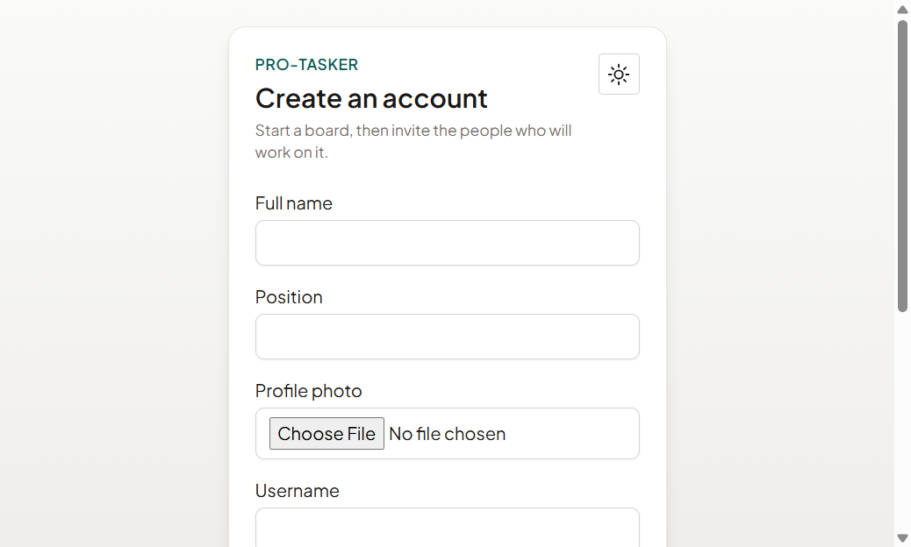
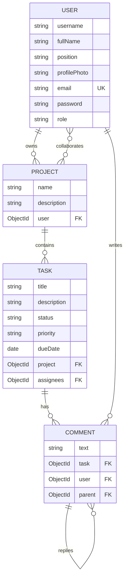
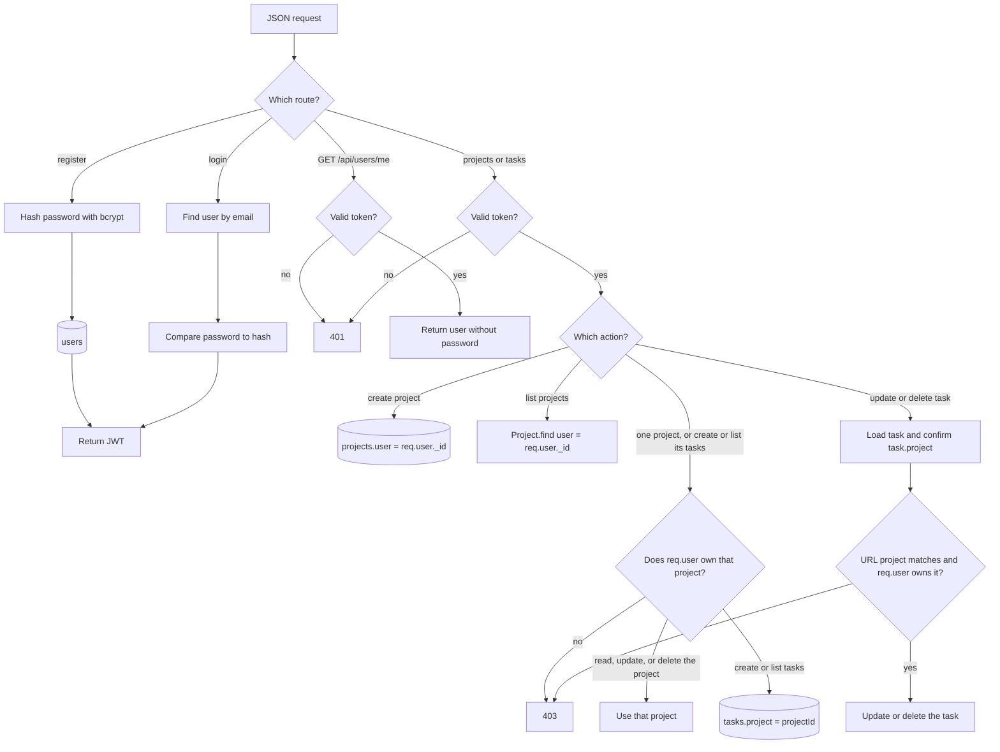
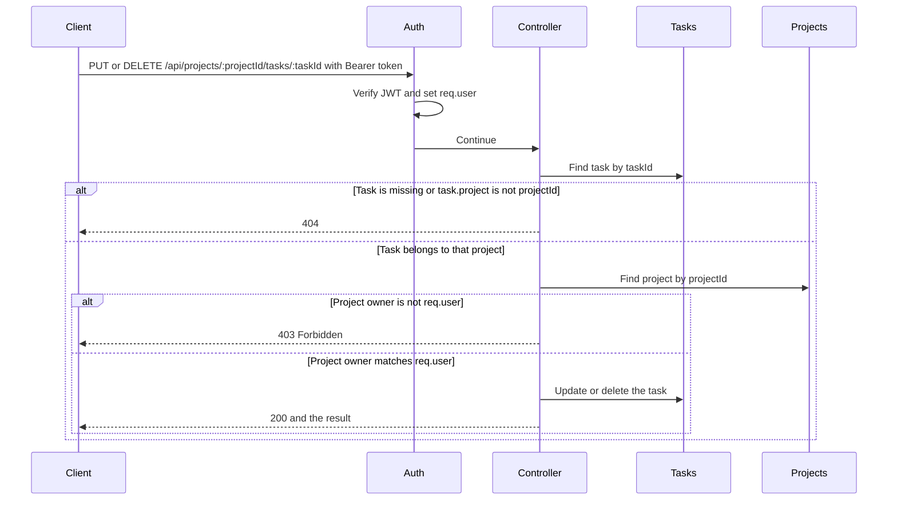

# Pro-Tasker

**Client delivery documentation**

| | |
| --- | --- |
| Product | Pro-Tasker |
| Version | 1.0 |
| Date | 14 October 2026 |
| Status | Delivered |
| Author | Mamadou Moussa BALDE |
| LinkedIn | https://www.linkedin.com/in/2mb/ |
| Repository | https://github.com/baldemoussa/Full-Stack-MERN-Application-Pro-Tasker |

This document describes the delivered application: what it does, how a person uses it, how it is built, how to run it, and how it is deployed. It is the handover record for the client. It does not contain passwords, database credentials, or the JWT signing secret.

---

## 1. Summary

Pro-Tasker is a web application for personal project tracking. A person creates an account, adds projects, and manages each project's tasks on a four-column board: **To Do**, **In Progress**, **Done**, and **Hold**.

Each account sees the projects it owns and the projects it is invited to. The browser stores a signed token for the current tab. The server checks that token on every project and task request, then checks that the caller is the owner or a collaborator.

The delivered system has two public addresses:

| Part | Address |
| --- | --- |
| Application | https://full-stack-mern-application-pro-tasker-1.onrender.com |
| API | https://full-stack-mern-application-pro-tasker.onrender.com |

The application is a React site. The API is an Express service. Both are hosted on Render. Data is stored in MongoDB Atlas.

---

## 2. Who this is for

| Reader | What to use |
| --- | --- |
| A person using the product | Section 4, User guide, and Section 5, Workflow |
| Someone installing or hosting it | Sections 13 through 15 |
| Someone integrating with the API | Sections 6, and 9 through 11 |
| Someone working on the interface | Section 7 |
| Someone deciding later work | Sections 16 and 17 |

---

## 3. What is included

### In this version

- Register, log in, and log out.
- A session that survives a refresh in the same browser tab and ends when the tab closes or after two hours.
- Create, view, update, and delete projects.
- Invite a registered user to a project as **view** or **edit**. The owner can change that permission or remove the person.
- Create, view, update, and delete tasks under a project when the caller can edit.
- A board with four columns. Drag a card onto another column, or change the status in **Edit**.
- An analytics page for the selected project: completion, a status pie chart, a 14-day trend line, priority, due dates, and who the tasks are assigned to.
- Deleting a project also deletes that project's tasks.
- Loading indicators while lists and saves are in progress.
- Error messages from the API, shown on the form that caused them.
- Light mode and night mode. The choice is saved in the browser.
- A layout that works on a desktop window and on a phone-width screen.
- A production deployment of the API and the application.

### Not in this version

- Email password reset or email verification. A signed-in person can edit their profile and change their password from the header.
- An admin console. The user record has a `role` field, and every new account is `user`. No screen treats `admin` differently.
- A server-side logout. Logging out removes the token in the browser. The token remains valid until it expires.
- Automated test suite. The backend `npm test` script is a placeholder.
- Hosted file uploads or notifications. A profile photo is stored on the user document.

---

## 4. User guide

Open https://full-stack-mern-application-pro-tasker-1.onrender.com.

The first request after the API has been idle can take about a minute. Render's free web service sleeps when it is not in use, then wakes on the next request.

### Create an account

1. Choose **Need an account? Register**.
2. Enter a full name, a position, a username, an email address, and a password of at least 5 characters. A profile photo is optional. A large photo is reduced to a small image before it is saved.
3. Choose **Create account**.

The application opens the dashboard. A new account has no projects.

If the username or email is already registered, the form shows the error returned by the API.

### Log in and log out

1. Enter the email and password on **Log in**.
2. Choose **Log in**.

The header shows the full name, position, and profile photo. The menu button opens **Profile**, **Password**, and **Log out**. **Profile** changes the full name, position, username, email, and profile photo. **Password** asks for the current password and a new password of at least 5 characters. **Log out** returns to the login page and ends the session in this tab.

A wrong email shows `Can't find this user`. A wrong password shows `Wrong password!`.

Refreshing the dashboard keeps the person signed in. Closing the tab ends the session. A token older than two hours is rejected, and the application returns to the login page.

### Projects

The left side of the dashboard is **My projects**.

- **Search projects** matches the name or the description. The open board stays in place while the list narrows. Clearing the box shows every project again.
- **New project** asks for a name and a description. Both are required.
- Selecting a project opens its board. A project you own can show **Shared**. A project someone shared with you shows **Can edit** or **View only**.
- The **Share** icon is available to the owner. Enter the email of a registered user and choose **Can edit** or **View only**. Inviting the same email again changes the permission. **Remove** takes that person off the project.
- **Edit** changes the name and description. Owners and people who can edit see this button. View-only people do not.
- The project actions are icons. The pencil edits the project, the person-plus shares it, the box archives it, the lock closes it, the circular arrows reopen it, and the trash can deletes it.
- **Close** is available to the owner of an open project. The project stays in the list, marked **Closed**, and the board becomes read only.
- **Archive** is available to the owner of an open or closed project. The project moves to the **Archived** list and the board stays read only.
- **Reopen** is available to the owner of a closed or archived project. The project returns to the open list and editing is allowed again.
- **Delete** asks for confirmation and is only shown to the owner. Confirming removes the project, every task on it, and every comment on those tasks.
- The chart icon opens **Analytics** for the project that is open. A pie chart shows how tasks split by status. A trend line shows how many tasks the project had on each of the last 14 days. The page also shows completion, overdue tasks, priority, and how many tasks each assigned person has finished. The project menu switches to another project. **Back to the board** returns to the dashboard.

### Tasks

With a project selected, the board shows **To Do**, **In Progress**, **Done**, and **Hold**. **Hold** is last, for tasks that are paused. On a small window each status is its own row. On a wide window the four statuses sit side by side.

- **New task** asks for a title, a description, a priority, an optional due date, people to assign, and a status. Priority is **Low**, **Medium**, or **High**, and starts as **Medium**. The status starts as **To Do**. **Assign to** lists only the people the project was shared with. The owner is not in that list. Check one or more people. Leave them all unchecked to leave the task unassigned. If nobody has been invited, the form says to share the project first. View-only people do not see this button.
- **Search tasks** matches the title, the description, or an assignee's name. The **Status** and **Priority** menus narrow the board. **Clear** removes the search and both filters. The overview counts stay for the whole project. Switching projects clears the search.
- An overview above the columns shows the **Owner**, the number of **Contributors** (people invited to the project), and counts **Total tasks**, **To Do**, **In Progress**, **Done**, and **Hold**.
- Drag a card onto another column, or onto a card in that column. The card moves, and the API saves the new status. If the save fails, the card returns to the column it left. Edit and Delete stay clickable.
- **Edit** on a card changes the title, description, priority, due date, assignees, and status. Each card shows its priority, its due date, and the photos of the people assigned to it. A due date before today is marked **Overdue** until the task is **Done**. Clearing the due date removes it. Removing a collaborator also removes that person from every task on the project.
- The comment icon opens the task thread. Anyone who can see the project can post a comment and reply to a comment. A reply cannot have its own replies. The author can delete their comment. The project owner can delete any comment. Deleting a comment also deletes its replies.
- **Delete** on a card asks for confirmation, then removes that task and its comments.

An empty column on a board you can edit says **Drop a task here**. A view-only column says **No tasks**. A view-only board explains that comments are allowed, and that drag, edit, and delete stay with people who can edit. An overdue card has a rose border.

### Appearance

The sun icon switches to night mode. The moon icon switches to light mode. The choice is kept in this browser under the name `pro-tasker-theme` and applies on the next visit, including after logout.

The page background is a soft stone gradient. Sign-in screens name the product and say what the account is for. Fields and cards are rounded. The header stays at the top and the product name returns to the dashboard. On a small window each status is its own row. On a wide window the four statuses sit side by side. An empty column you can edit says **Drop a task here**. An overdue card has a rose border.

### Screenshots

These pictures are from a local session. The live application uses the same screens.

#### Dashboard



#### Board



#### Analytics





#### Night mode



#### Log in



#### Create an account



### Pages

| Address | What the person sees |
| --- | --- |
| `/login` | Login form. A signed-in person is sent to the dashboard. |
| `/register` | Registration form. A signed-in person is sent to the dashboard. |
| `/dashboard` | Project list and the task board. A guest is sent to login. |
| `/analytics` | Analytics for the first open project. A guest is sent to login. |
| `/analytics/:projectId` | Analytics for that project. Anyone who can view the project can open it. |
| `/projects/:projectId` | A signed-in placeholder page that shows the id and **Back to projects**, which opens the dashboard. The board itself is the dashboard. |
| Any other path | Redirects to `/dashboard`. |

Refreshing `/login`, `/register`, or `/dashboard` loads the application again. Render rewrites those paths to `index.html`, and React Router chooses the page.

---

## 5. Workflow

Every change follows the same round trip. The screen never talks to MongoDB. A page calls a hook, the hook calls the API with the token, and the API writes or reads the database.

```text
Person
  -> Page (LoginPage, RegisterPage, or DashboardPage)
    -> Component (form, card, or column) collects the action
      -> Hook (useApi for writes, useFetch for reads)
        -> Token (sessionStorage, sent as Authorization: Bearer)
          -> Express route
            -> authMiddleware on protected routes
              -> Controller
                -> Mongoose model
                  -> MongoDB
  <- JSON response updates the page state
```

### Sign in

1. `LoginPage` or `RegisterPage` checks the form, then calls `login` or `register` from `useAuth()`.
2. `AuthProvider` sends the body through `useApi` to `POST /api/users/login` or `POST /api/users/register`. No token is sent yet.
3. The API checks the account, hashes a new password on register, and returns `{ token, user }`.
4. `AuthProvider` stores the token with `setToken` in `sessionStorage` and in React state.
5. `useFetch` then calls `GET /api/users/me` with `Authorization: Bearer <token>`.
6. The dashboard is shown only after `/me` returns the account. That response has no password.
7. A refresh reads the same token from `sessionStorage` and repeats step 5. Closing the tab clears `sessionStorage`. **Log out** deletes the token in the browser. The API has no logout route.

While `/me` is in progress, route guards show **Loading...**. The login and register buttons use a separate `submitting` flag, so the form stays on screen during the request.

### Open the board

1. `DashboardPage` reads `token` from `useAuth()`.
2. `useFetch` calls `GET /api/projects` with that token. Until a token exists, the URL passed to `useFetch` is `null` and no request runs.
3. The returned array is copied into the page's `projects` state. The first project is selected when none is selected yet.
4. Selecting a project changes `selectedId`. The page clears the task list, then `useFetch` calls `GET /api/projects/:projectId/tasks`.
5. `TaskColumn` receives the tasks for one status. `TaskCard` renders each task.

### Change a record

1. A button on `DashboardPage` opens a `Modal`.
2. `ProjectForm` or `TaskForm` collects the fields and calls `onSubmit` with the body. The form does not know the token or the API address.
3. The page handler calls `post`, `put`, or `del` on its `useApi` instance. That instance was created with `{ token }`, so the bearer header is added.
4. On success the hook returns the JSON record. The page appends it, replaces it, or removes it in `projects` or `tasks`. It does not send another GET.
5. On failure the hook returns `null` and keeps the API `message` on `error`. The dialog shows that message. The list on screen is left as it was.

Create and update use one `useApi` instance. Delete uses another. A delete error therefore cannot appear on the create form.

### Move a task

Dragging a card onto another column, or editing it and choosing **In Progress**, **Done**, or **Hold**, sends `PUT /api/projects/:projectId/tasks/:taskId` with the new `status`. The page moves the card immediately. Each column shows only the tasks whose `status` matches its heading. A failed drag puts the card back. View-only collaborators cannot drag.

---

## 6. Backend data workflow

A user owns many projects. A project contains many tasks. The link is stored as an id, not a nested document.



Registration writes a user. Login and `GET /api/users/me` only read that user and return a token or the account. Project and task writes happen after the token is checked.



Updating or deleting a task is the longest path, because the task document does not store the owner. The owner lives on the parent project, and the task must also belong to the project id in the URL.



`server.js` loads environment variables, creates the Express app, and opens MongoDB. The process does not listen until the connection emits `open`.

Every request then passes through the same gate before a controller runs:

```text
Incoming HTTP request
  -> CORS (allow CLIENT_URL and http://localhost:5173 when CLIENT_URL is set)
  -> express.urlencoded and express.json
  -> routes/index.js
       GET /                         health JSON, no database
       /api/*                        routes/api/index.js
       anything else                 404 HTML
```

`routes/api/index.js` mounts two routers:

| Mount | Router | Middleware |
| --- | --- | --- |
| `/api/users` | `userRoutes.js` | `authMiddleware` on `GET /me` only |
| `/api/projects` | `projectRoutes.js` | `authMiddleware` on the whole router, including nested tasks |

Task routes are registered before `GET /api/projects/:id`, so the path segment `tasks` is not treated as a project id.

### Unprotected writes: register and login

```text
POST /api/users/register
  -> registerUser
       -> User.create(req.body)
            -> pre-save hook hashes password with bcrypt (10 rounds)
       -> signToken(user)   payload { data: { username, email, _id } }, expires in 2h
       -> 201 { token, user }

POST /api/users/login
  -> loginUser
       -> User.findOne({ email })
            missing user -> 400 "Can't find this user"
       -> user.isCorrectPassword(password)
            mismatch -> 400 "Wrong password!"
       -> signToken(user)
       -> 200 { token, user }
```

No project or task is created at registration. The new user simply has an empty project list.

### Protected read: current user

```text
GET /api/users/me
  -> authMiddleware
       no token        -> 401
       invalid token   -> 401
       valid token     -> req.user = { username, email, _id }
  -> getMe
       -> User.findById(req.user._id).select('-password')
       -> 200 user, or 404 when that id is gone
```

### Project data

The owner is never taken from the client on create. The controller writes `user: req.user._id` and starts `collaborators` as an empty list. On update, `user`, `collaborators`, and `access` are removed from the body, so a caller cannot reassign the project or edit the invite list through the project update.

```text
POST /api/projects
  -> authMiddleware
  -> createProject
       -> Project.create({ ...body, user: req.user._id })
       -> 201 project

GET /api/projects
  -> authMiddleware
  -> getAllProjects
       -> Project.find owner or collaborator
       -> 200 array, each item includes access: owner, edit, or view

GET /api/projects/:id
  -> authMiddleware
  -> load the project
       missing                                      -> 404
       caller is not owner or collaborator          -> 403
       owner, edit, or view                         -> 200

PUT /api/projects/:id
  -> owner or edit -> update name and description
  -> view or outsider -> 403

DELETE /api/projects/:id
  -> owner only
  -> anyone else -> 403
```

Delete is two writes. `Task.deleteMany({ project: project._id })` runs first. `Project.findByIdAndDelete` runs only after that. A failed ownership check deletes nothing.

### Task data

A task has no owner field. The workflow loads the parent project and checks the caller's access. View, edit, and owner can read tasks. Only edit and owner can create, update, or delete them. The task's `project` value comes from `:projectId` in the URL, not from the body. On update, `project` is removed from the body so a caller cannot move a task onto another project.

```text
POST /api/projects/:projectId/tasks
  -> authMiddleware
  -> load the project
       missing or not owned -> 404 or 403
  -> Task.create({ ...body, project: projectId })
  -> 201 task

GET /api/projects/:projectId/tasks
  -> authMiddleware
  -> same project ownership check
  -> Task.find({ project: projectId })
  -> 200 array

PUT or DELETE /api/projects/:projectId/tasks/:taskId
  -> authMiddleware
  -> Task.findById(taskId)
       missing, or task.project !== :projectId -> 404
  -> load the parent project and compare the owner
       not owned -> 403
  -> findByIdAndUpdate, or findByIdAndDelete
  -> 200 updated task, or { message: "Task deleted!" }
```

`status` is the only field that changes which column a task belongs to. Allowed values are `To Do`, `In Progress`, `Done`, and `Hold`. An unknown status fails Mongoose validation and returns **400**. The default on create is `To Do`. `priority` is `Low`, `Medium`, or `High`, and defaults to `Medium`. The board search and filters run in the browser on the tasks already loaded for the open project.

### What each layer is allowed to do

| Layer | Responsibility | What it does not do |
| --- | --- | --- |
| `server.js` | CORS, JSON body, start after the database opens | No business rules |
| `routes/` | Match the URL and attach `authMiddleware` | No database calls |
| `utils/auth.js` | Verify the token and set `req.user` | No project or task checks |
| Controllers | Ownership, strip `user` or `project` from updates, choose the status code | No password hashing |
| Models | Field rules, password hash on save, password compare | No HTTP |

---

## 7. Frontend communication

The interface is split so that pages decide what happens, components display it, and hooks perform HTTP. The token is the only credential, and it lives in one place.

```text
App
  AuthProvider          holds token, user, login, register, logout
    ThemeProvider       holds light / night mode (separate from the token)
      Routes
        GuestRoute      /login, /register
        ProtectedRoute  /dashboard, /projects/:projectId
```

`AuthContext` is only the contract: the shape of `user`, `token`, `isAuthenticated`, `loading`, `submitting`, `error`, `login`, `register`, and `logout`. `AuthProvider` is the only file that fills those values. Pages call `useAuth()` and do not import the provider.

### Token

| Step | Code | Result |
| --- | --- | --- |
| Read on startup | `getToken()` in `utils/token.ts` | `sessionStorage` key `pro-tasker-token` (`VITE_TOKEN_KEY`) |
| Save after login or register | `setToken(token)` and `setTokenState` | The next refresh and the current screen both see it |
| Attach to a GET | `authHeaders(token)` | `{ Authorization: "Bearer <token>" }`, or no header when the token is null |
| Attach to a write | `useApi({ token })` | The same bearer header inside `execute` |
| Remove | `clearToken()` from `logout`, or when `/me` fails | `user` becomes null and route guards send the person to `/login` |

`isAuthenticated` is true only when `/me` has returned a user. A token by itself is not enough. `loading` is true only while a token is waiting for `/me`. `submitting` is true only while login or register is in flight. Those two flags are separate so the login form is not unmounted during submit.

Night mode does not use the token. `ThemeProvider` reads and writes `localStorage` key `pro-tasker-theme`.

### Hooks

| Hook | Methods | Who calls it | When it runs |
| --- | --- | --- | --- |
| `useApi` | `post`, `put`, `del` | `AuthProvider` for login and register. `DashboardPage` for project and task changes | Only when the page calls it |
| `useFetch` | GET | `AuthProvider` for `/api/users/me`. `DashboardPage` for projects and tasks | When its URL is a string. A `null` URL skips the request |

`useApi` prefixes `VITE_API_URL` unless the caller already passed an absolute URL. A failed response becomes `error` with the API `message` when the body has one, and the call returns `null`. `loading` is cleared in `finally`.

`useFetch` refetches when the URL or the Authorization header text changes. It clears the previous `data` as soon as that key changes, so logout cannot keep showing the previous user while the next request is still out. A response that arrives after a newer request has started is ignored.

`DashboardPage` keeps a separate `useApi` instance for each kind of write:

| Instance | Used for |
| --- | --- |
| `projectApi` | Create and update a project |
| `projectDeleteApi` | Delete a project |
| `taskApi` | Create and update a task |
| `taskDeleteApi` | Delete a task |
| `moveApi` | Save a drag onto another column |
| `inviteApi` | Invite or remove a collaborator |

Each instance has its own `error` and `loading`. The spinner on **Delete project** does not replace the spinner on **Create project**.

### Pages and components

Pages own the data and the handlers. Components receive props and call back. No presentational component imports `useApi`, `useFetch`, or `token.ts`.

| Page | Reads | Calls | Renders |
| --- | --- | --- | --- |
| `LoginPage` | `login`, `error`, `submitting` | `login({ email, password })`, then `navigate("/dashboard")` | Form fields, `Alert`, `ThemeToggle` |
| `RegisterPage` | `register`, `error`, `submitting` | `register({ fullName, position, profilePhoto, username, email, password })` | Form fields, `Alert`, `ThemeToggle` |
| `DashboardPage` | `token` | `useFetch` for both lists; `useApi` for every save, delete, drag, and invite | `AppHeader`, `ProjectCard`, `TaskBoard`, `Modal`, forms |
| `ProjectPage` | The `:projectId` param | None | `AppHeader` and a back link. This is not the board |

| Component | Receives | Sends upward | Does not receive |
| --- | --- | --- | --- |
| `ProjectForm` | `initialValues`, `submitLabel`, `submitting`, `error` | `onSubmit({ name, description })`, `onCancel` | Token, project id |
| `TaskForm` | Title, description, priority, assignees, and status | `onSubmit({ title, description, status, priority, assignees })` | Token, project id |
| `ProjectCard` | `project`, `selected` | `onSelect(projectId)` | The task list |
| `TaskBoard` | `tasks`, `canEdit` | `onMove`, `onEdit`, `onDelete` | The token |
| `TaskColumn` | `status`, the tasks for that status, `canEdit` | `onEdit`, `onDelete` | Other columns |
| `TaskCard` | One `task`, `canEdit` | `onEdit(task)`, `onDelete(task)`, drag listeners | The API |
| `CollaboratorForm` | `collaborators`, `submitting`, `error` | `onInvite`, `onRemove` | The token |
| `Modal` | `title`, `children` | `onClose` | Form state. Unmounting the modal resets the form |
| `AppHeader` | `user` and `logout` from `useAuth()` | Calls `logout` and opens the password form. The theme button uses `useTheme()` | Projects or tasks |
| `ProtectedRoute` | `isAuthenticated`, `loading` | Redirects guests to `/login` | — |
| `GuestRoute` | `isAuthenticated`, `loading` | Redirects a signed-in person to `/dashboard` | — |
| `Alert` | `message` | — | — |
| `Spinner` | `label` | — | — |

`DashboardPage` is the only place that connects a form submission to a URL. For example, save task does this:

```text
TaskForm.onSubmit(body)
  -> DashboardPage.handleSaveTask
       -> taskApi.put or taskApi.post
            URL includes selectedId and, for edit, the task id
            body is title, description, status, priority, and assignees
       -> setTasks replaces or appends the returned task
       -> close the modal
```

`ProjectCard` only reports which id was clicked. The page stores that id, and the task `useFetch` runs because its URL now includes it.

---

## 8. Architecture

```text
Browser
  React application (Vite static site on Render)
        |
        |  HTTPS, JSON, Authorization: Bearer <token>
        v
  Express API (Render Web Service)
        |
        |  Mongoose
        v
  MongoDB Atlas
```

The API does not serve the React files. The static site is built with the API address baked in as `VITE_API_URL`. Changing that address requires a new frontend build.

The API listens on `process.env.PORT`, or `3001` when that variable is absent. Local development sets `PORT=3000`. Render sets `PORT` itself. The production service must not set `PORT` to `3000`.

The API connects to MongoDB before it accepts traffic. The connection string is `MONGO_URI`.

### Repository layout

```text
Backend/
  config/connection.js       MongoDB connection
  controllers/               User, project, and task handlers
  models/                    User, Project, Task
  routes/index.js            Health check, /api mount, 404
  routes/api/                /api/users and /api/projects
  utils/auth.js              Sign a token and require one
  server.js                  Express app, CORS, listen
  package.json
Frontend/
  public/                    Favicon, icons, and a redirects file
  src/components/            Header, forms, cards, columns, modal, alerts
  src/context/               Auth and theme contracts
  src/hooks/                 useApi for writes, useFetch for reads
  src/pages/                 Login, register, dashboard, analytics, project placeholder
  src/providers/             Session state and light/night mode
  src/types/index.ts         Shared TypeScript types
  src/utils/                 Token storage and auth headers
  package.json
README.md                    Short developer setup
DOCUMENTATION.md             This document
```

`Backend/.env` and `Frontend/.env` are not in the repository. `node_modules/` is not in the repository.

### Technology

| Layer | Choice | Role in this product |
| --- | --- | --- |
| Frontend | React 19, TypeScript, Vite 8 | Screens and client-side routing |
| Routing | React Router 7 | `/login`, `/register`, `/dashboard`, `/projects/:projectId` |
| Styling | Tailwind CSS 3.4 | Layout, light mode, night mode |
| Motion | Motion | Card enter, exit, and drag overlay |
| Drag and drop | dnd-kit | Moving a task between columns |
| Font | Plus Jakarta Sans | Loaded from Google Fonts for the whole application |
| Backend | Node.js, Express 5 | HTTP API |
| Data | Mongoose 9, MongoDB Atlas | Users, projects, and tasks |
| Passwords | bcrypt, 10 salt rounds | Hashed before save |
| Sessions | jsonwebtoken | Signed token, 2-hour expiry |
| Hosting | Render | Static site and web service |

---

## 9. Data model

MongoDB collection names follow Mongoose defaults: `users`, `projects`, and `tasks`. Every document has `_id`, `createdAt`, and `updatedAt`.

### User

| Field | Rules |
| --- | --- |
| `username` | Required, unique, trimmed |
| `email` | Required, unique, must match an email pattern |
| `password` | Required, at least 5 characters, stored as a bcrypt hash |
| `role` | `admin` or `user`. Default `user`. Not used by the screens |
| `fullName` | Required, trimmed |
| `position` | Required, trimmed |
| `profilePhoto` | Optional image address or image data. Empty by default |

The password is hashed in a pre-save hook when the user is created or the password changes. Comparison uses `isCorrectPassword`.

### Project

| Field | Rules |
| --- | --- |
| `name` | Required, trimmed |
| `description` | Required, trimmed |
| `user` | Required ObjectId reference to User. Set by the server from the token. A client cannot replace it on update |
| `status` | `active`, `closed`, or `archived`. Default `active`. Only the owner changes it, through the close, archive, and reopen routes. A client cannot set it on create or update |
| `collaborators` | List of `{ user, permission }`. `permission` is `view` or `edit`. Only the owner can change this list, through the collaborator routes |
| `access` | Not stored. Each response sets `owner`, `edit`, or `view` for the caller |

`GET /api/projects` returns projects the caller owns and projects where the caller is a collaborator.

### Task

| Field | Rules |
| --- | --- |
| `title` | Required, trimmed |
| `description` | Required, trimmed |
| `status` | `To Do`, `In Progress`, `Done`, or `Hold`. Default `To Do` |
| `priority` | `Low`, `Medium`, or `High`. Default `Medium`. Tasks saved before this field existed are returned as `Medium` |
| `dueDate` | Optional calendar date, stored as `YYYY-MM-DD`. Empty means no due date. A status-only update leaves it in place |
| `assignees` | List of user ids. Each person must be someone the project was shared with. The owner cannot be assigned. Empty by default. The list response includes each person's name, position, and profile photo, and leaves out anyone who is no longer a collaborator |
| `project` | Required ObjectId reference to Project. Set from the URL. A client cannot replace it on update |

A task has no owner field of its own. Who may change it depends on the parent project: the owner and `edit` collaborators can change tasks. A `view` collaborator can read them.

### Comment

| Field | Rules |
| --- | --- |
| `text` | Required, trimmed, at most 1000 characters |
| `task` | Required ObjectId reference to Task. Set from the URL |
| `user` | Required ObjectId reference to User. Set from the token |
| `parent` | Optional ObjectId reference to a comment on the same task. Empty for a comment on the task. A reply's parent must itself have no parent |

Anyone who can view the project can read and write comments. The author can delete their own comment. The project owner can delete any comment on the project. Deleting a comment also deletes replies whose `parent` is that comment.

### Relationships

```text
User 1 ──── * Project 1 ──── * Task 1 ──── * Comment
User * ──── * Project   (collaborators, view or edit)
User 1 ──── * Comment
Comment 1 ──── * Comment   (replies)
```

Deleting a project deletes its tasks and the comments on those tasks, then deletes the project. Deleting a task deletes its comments. Deleting a user is not implemented, so projects are not removed when an account would be removed.

---

## 10. Security

### Authentication

- Register and login return a JWT signed with `JWT_SECRET`.
- The payload is `{ data: { username, email, _id } }`.
- Expiry is 2 hours (`expiresIn` and `maxAge`).
- Protected routes read `Authorization: Bearer <token>`. A token in `req.body.token` or `req.query.token` is also accepted by the middleware.
- Missing token: **401** `You must be logged in to do that.`
- Invalid or expired token: **401** `Invalid token.`
- The middleware sets `req.user` to `{ username, email, _id }`.

### Authorization

`utils/access.js` reads the project and returns `owner`, `edit`, `view`, or nothing.

- **Owner** can do everything, including share, remove collaborators, and delete the project.
- **Edit** can read and update the project, and can create, update, and delete its tasks. Edit cannot delete the project or change the invite list.
- **View** can read the project and its tasks. View cannot change them.
- A caller with no access: **403** with a message that names the action, for example `User is not authorized to update this task.`
- Missing project or task: **404**.
- A task whose `project` does not match `:projectId`: **404** `No task found with this id!`, including when the task exists under a different project.

### Browser policy

When `CLIENT_URL` is set, the API allows that origin and `http://localhost:5173`. Other browser origins are rejected. Requests with no `Origin` header, such as the health check, are allowed.

When `CLIENT_URL` is unset, every origin is allowed. Local development leaves it unset. Production sets it to:

`https://full-stack-mern-application-pro-tasker-1.onrender.com`

No trailing slash. The value must match the browser origin exactly.

The application sends the token in the `Authorization` header. It does not use cookies, so CORS credentials are not enabled.

### Secrets

| Secret | Where it lives |
| --- | --- |
| `MONGO_URI` | `Backend/.env` locally, Render environment for the API |
| `JWT_SECRET` | Same |
| Database password | Inside `MONGO_URI` only |

These values are not written in this document or in the repository. Atlas network access must allow Render to connect. Render does not use one fixed address, so the cluster allows `0.0.0.0/0`.

### Client delivery notes on security

- Login and register responses include the user document returned by Mongoose, which still contains the password hash. The application does not display that field. It loads `GET /api/users/me`, and that response excludes `password`. A later release should omit the hash from the login and register JSON as well.
- There is no rate limit, account lockout, or email verification.
- Logout does not revoke the token on the server.
- Validation failures on some routes return the raw Mongoose error object with status **400**, not a single `{ message }` string.

---

## 11. API reference

Base URL in production:

`https://full-stack-mern-application-pro-tasker.onrender.com`

Send `Content-Type: application/json` for bodies. Send `Authorization: Bearer <token>` on every route except register, login, and the health check.

### Health

| Method | Path | Auth | Success |
| --- | --- | --- | --- |
| GET | `/` | No | **200** `{ "message": "Pro-Tasker API is running." }` |

Any other unknown path returns **404** and the HTML body `<h1>😝 404 Error!</h1>`.

### Users

#### POST `/api/users/register`

No token.

```json
{
  "username": "ada",
  "fullName": "Ada Lovelace",
  "position": "Project lead",
  "profilePhoto": "",
  "email": "ada@example.com",
  "password": "secret1"
}
```

**201**

```json
{
  "token": "<jwt>",
  "user": {
    "_id": "<id>",
    "username": "ada",
    "fullName": "Ada Lovelace",
    "position": "Project lead",
    "profilePhoto": "",
    "email": "ada@example.com",
    "password": "<bcrypt hash>",
    "role": "user",
    "createdAt": "<date>",
    "updatedAt": "<date>"
  }
}
```

**400** when the body fails validation, or when the username or email is already used.

#### POST `/api/users/login`

No token.

```json
{
  "email": "ada@example.com",
  "password": "secret1"
}
```

**200** with the same `{ token, user }` shape as register.

| Condition | Status | Body |
| --- | --- | --- |
| Unknown email | 400 | `{ "message": "Can't find this user" }` |
| Wrong password | 400 | `{ "message": "Wrong password!" }` |

#### GET `/api/users/me`

Token required.

**200** is the user without `password`.

**404** `{ "message": "No user found with this id!" }` when the token's id no longer matches a user.

#### PUT `/api/users/me`

Token required. Updates the signed-in profile. `role` and `password` cannot be changed here.

```json
{
  "fullName": "Ada Lovelace",
  "position": "Project lead",
  "username": "ada",
  "email": "ada@example.com",
  "profilePhoto": ""
}
```

**200** returns the user without `password`. The current token stays valid. The header uses this response immediately.

| Condition | Status | Message |
| --- | --- | --- |
| A required field is missing | 400 | `Full name, position, username, and email are required.` |
| Email is not a valid address | 400 | `Must use a valid email address` |
| Username belongs to someone else | 400 | `That username is already used.` |
| Email belongs to someone else | 400 | `That email is already used.` |
| Profile photo is not an image or is too large | 400 | Mongoose validation error |
| Token's user no longer exists | 404 | `No user found with this id!` |

#### PUT `/api/users/me/password`

Token required.

```json
{
  "currentPassword": "secret1",
  "newPassword": "secret2"
}
```

**200** `{ "message": "Password updated." }`. The response does not include the password. The current token stays valid.

| Condition | Status | Message |
| --- | --- | --- |
| Current password does not match | 400 | `Wrong password!` |
| A field is missing | 400 | `Current password and new password are required.` |
| New password is shorter than 5 characters | 400 | `Password must be at least 5 characters.` |
| New password matches the current password | 400 | `Choose a different password.` |
| Token's user no longer exists | 404 | `No user found with this id!` |

### Projects

All of these require a token. Responses include `access` for the caller. `user`, `collaborators`, and `access` in a create or update body are discarded.

#### POST `/api/projects`

```json
{
  "name": "Launch checklist",
  "description": "Work for the demo"
}
```

**201** returns the created project. **400** when `name` or `description` is missing.

#### GET `/api/projects`

**200** returns projects the caller owns or is invited to. The array is empty when the caller has none. **500** on a database error.

#### GET `/api/projects/:id`

| Condition | Status | Message |
| --- | --- | --- |
| Owner, edit, or view | 200 | The project, including `access` and `collaborators` |
| Missing | 404 | `No project found with this id!` |
| No access | 403 | `User is not authorized to view this project.` |

#### PUT `/api/projects/:id`

Body: `name` and `description`. Owner and edit may call it. View may not.

**200** returns the updated project. **404** and **403** use the messages `No project found with this id!` and `User is not authorized to update this project.`

#### DELETE `/api/projects/:id`

Owner only. **200** `{ "message": "Project deleted!" }`.

Tasks with that `project` id are deleted first. **404** and **403** use `No project found with this id!` and `User is not authorized to delete this project.`

#### PUT `/api/projects/:id/close`, `/archive`, and `/reopen`

Owner only. No body. Each route sets `status` to `closed`, `archived`, or `active`.

**200** returns the project. A closed or archived project can still be read. Creating or changing tasks, comments, the project name, and collaborators returns **403** until the owner reopens it.

| Condition | Status | Message |
| --- | --- | --- |
| Caller is not the owner | 403 | `Only the project owner can change this project.` |
| The project is already in that state | 400 | `This project is already closed.`, `already archived.`, or `already open.` |
| Project missing | 404 | `No project found with this id!` |

#### POST `/api/projects/:id/collaborators`

Owner only.

```json
{
  "email": "ada@example.com",
  "permission": "edit"
}
```

`permission` is `view` or `edit`. The email must belong to a registered user, and it cannot be the owner's email. Inviting someone who is already a collaborator changes their permission.

| Condition | Status | Message |
| --- | --- | --- |
| New collaborator | 201 | The project |
| Permission changed | 200 | The project |
| Caller is not the owner | 403 | `Only the project owner can invite collaborators.` |
| Missing email | 400 | `Email is required.` |
| Bad permission | 400 | `Permission must be view or edit.` |
| Email is not registered | 404 | `No registered user with that email.` |
| Email is the owner | 400 | `The owner is already on this project.` |

#### DELETE `/api/projects/:id/collaborators/:userId`

Owner only. **200** returns the project without that collaborator.

**403** `Only the project owner can remove collaborators.`

**404** `That person is not a collaborator on this project.`

### Tasks

Task routes are registered before `/api/projects/:id`, so the word `tasks` is not treated as a project id.

All of these require a token. The server checks the caller's access on the parent project. View can list tasks. Edit and owner can create, update, and delete them. `project` in an update body is discarded.

#### POST `/api/projects/:projectId/tasks`

```json
{
  "title": "Draft the demo script",
  "description": "Outline register, projects, and tasks",
  "status": "To Do",
  "priority": "High",
  "dueDate": "2026-10-20",
  "assignees": ["USER_ID"]
}
```

`status` may be omitted and then defaults to `To Do`. Allowed values are `To Do`, `In Progress`, `Done`, and `Hold`. `priority` may be omitted and then defaults to `Medium`. Allowed values are `Low`, `Medium`, and `High`. `assignees` may be omitted and then defaults to an empty list. Each id must be a collaborator the project was shared with. The project owner is rejected. The same person is stored once. `dueDate` may be omitted or `null`. It must be `YYYY-MM-DD` when it is present. A status-only update, such as a drag, leaves the current assignees and due date in place. A response still omits an assignee who is no longer a collaborator.

**201** returns the created task.

| Condition | Status | Message |
| --- | --- | --- |
| Project missing | 404 | `No project found with this id!` |
| Caller cannot edit the project | 403 | `User is not authorized to create a task for this project.` |
| Missing title or description, or a bad status or priority | 400 | Mongoose validation error |
| Assignee is the owner, or is not a collaborator | 400 | `Tasks can only be assigned to someone this project was shared with.` |
| `assignees` is not a list | 400 | `Assignees must be a list of people this project was shared with.` |
| Bad due date | 400 | `Due date must be a valid date.` |

#### GET `/api/projects/:projectId/tasks`

**200** returns an array of tasks for that project.

**404** `No project found with this id!`.

**403** `User is not authorized to view tasks for this project.`

#### PUT `/api/projects/:projectId/tasks/:taskId`

Body may include `title`, `description`, and `status`.

**200** returns the updated task. A new `status` is how a card changes column.

| Condition | Status | Message |
| --- | --- | --- |
| Task missing, or task belongs to another project id | 404 | `No task found with this id!` |
| Parent project missing | 404 | `No project found with this id!` |
| Caller cannot edit the parent | 403 | `User is not authorized to update this task.` |
| Validation failure | 400 | Mongoose validation error |

#### DELETE `/api/projects/:projectId/tasks/:taskId`

**200** `{ "message": "Task deleted!" }`. The task's comments are deleted with it.

**404** uses the same task and project messages as update. **403** is `User is not authorized to delete this task.`

### Comments

Comment routes sit under a task. Anyone who can view the project can list and create comments. The author, and the project owner, can delete a comment.

#### GET `/api/projects/:projectId/tasks/:taskId/comments`

**200** returns the task's comments, oldest first. Each comment includes the author fields `username`, `fullName`, `position`, and `profilePhoto`. `parent` is `null` on a comment written on the task, or the id of that comment when the row is a reply.

**404** `No task found with this id!` when the task is missing or belongs to another project.

**403** `User is not authorized to view this task.`

#### POST `/api/projects/:projectId/tasks/:taskId/comments`

```json
{
  "text": "Looks ready for review.",
  "parent": "<comment id, omit for a comment on the task>"
}
```

**201** returns the created comment with the author filled in.

| Condition | Status | Message |
| --- | --- | --- |
| Task missing, or task belongs to another project | 404 | `No task found with this id!` |
| Caller cannot view the project | 403 | `User is not authorized to view this task.` |
| Empty text | 400 | `Comment text is required.` |
| `parent` is missing or belongs to another task | 404 | `No comment found with this id!` |
| `parent` is itself a reply | 400 | `A reply cannot have its own replies.` |

#### DELETE `/api/projects/:projectId/tasks/:taskId/comments/:commentId`

**200** `{ "message": "Comment deleted!" }`. Replies of that comment are deleted too.

**403** `User is not authorized to delete this comment.`

**404** `No comment found with this id!` when the comment is missing or belongs to another task.

### Status codes used

| Code | Meaning in this API |
| --- | --- |
| 200 | Read, update, delete, login, or health check succeeded |
| 201 | User, project, task, or comment created |
| 400 | Validation failure, unknown email, or wrong password |
| 401 | Missing, invalid, or expired token |
| 403 | The caller is not allowed to perform that action on the project |
| 404 | The record does not exist, or a task is not under the given project |
| 500 | Unexpected database error on project reads, project updates, project deletes, task lists, and task deletes. Task update errors return 400 |

---

## 12. Client application

### Environment

Create `Frontend/.env` for local development. Do not commit it.

```env
VITE_API_URL=http://localhost:3000
VITE_TOKEN_KEY=pro-tasker-token
```

Vite reads variables that start with `VITE_` at build time. Production values are set on the Render static site, not in the file above. `VITE_API_URL` has no trailing slash, because the code appends `/api/...`.

If either variable is missing, the application throws when it loads.

### Scripts

From the `Frontend` directory:

| Command | Result |
| --- | --- |
| `npm install` | Install dependencies |
| `npm run dev` | Vite dev server, usually http://localhost:5173 |
| `npm run build` | Typecheck with `tsc -b`, then production build into `dist/` |
| `npm run preview` | Serve the production build locally |
| `npm run lint` | ESLint |

### Main modules

| Module | Responsibility |
| --- | --- |
| `AuthProvider` | Token, current user, login, register, logout, loading, and submitting |
| `ThemeProvider` | Light or night mode, and the `dark` class Tailwind reads |
| `useApi` | `POST`, `PUT`, and `DELETE`. Prefixes `VITE_API_URL`, sends the bearer token, and returns `null` on failure |
| `useFetch` | `GET`. A null URL skips the request |
| `DashboardPage` | Project list, board, and the create, edit, and delete dialogs |
| `AnalyticsPage` | Status, priority, completion, and assignment numbers for one project |
| `ProtectedRoute` | Guests go to `/login`. Waits while the session is restoring |
| `GuestRoute` | Signed-in people go to `/dashboard` |

`useApi` is the write path for login, register, and every project and task change. `useFetch` is the read path for `/api/users/me`, the project list, and the task list.

### Theme

`ThemeProvider` wraps the application in a `dark` class when night mode is on. Tailwind is configured with `darkMode: "class"`, so night styles apply to descendants of that class. The preference is `localStorage` key `pro-tasker-theme`, with values `dark` or `light`.

The page background is a soft stone gradient. Sign-in screens name the product and say what the account is for. On a small window each status is its own row. On a wide window the four statuses sit side by side. An empty column says **Drop a task here**. An overdue card has a rose border. On a narrow screen the project list is height-limited and the actions stack under the title.

---

## 13. Local installation

Requirements: Node.js 20 or newer, npm, and a MongoDB Atlas cluster (or another MongoDB the connection string can reach).

Use two terminals. Start the API before the client.

### API

```bash
cd Backend
npm install
```

Create `Backend/.env`:

```env
PORT=3000
MONGO_URI=your-mongodb-connection-string
JWT_SECRET=your-long-random-secret
```

`PORT` defaults to `3001` if it is omitted. This project uses `3000` so it matches `VITE_API_URL`.

```bash
npm run dev
```

`npm start` runs `node server.js` without nodemon. That is the production start command.

Confirm the API with http://localhost:3000/. The body is `{ "message": "Pro-Tasker API is running." }`. `GET /api/projects` without a token returns **401**.

### Application

```bash
cd Frontend
npm install
npm run dev
```

Open the URL Vite prints, usually http://localhost:5173.

### Suggested manual check

1. Register a new account.
2. Confirm the dashboard is empty and the header shows the full name and position.
3. Create a project.
4. Create a task. It appears under **To Do**.
5. Edit the task and set the status to **In Progress**. The card moves.
6. Log out. The login page appears.
7. Log in. The project and task are still there.
8. Delete the task, then delete the project.

---

## 14. Production deployment

Both services deploy from the `main` branch of https://github.com/baldemoussa/Full-Stack-MERN-Application-Pro-Tasker. The Git root contains `Frontend` and `Backend`, so each Render service sets its own root directory.

### API (Render Web Service)

| Setting | Value |
| --- | --- |
| Root directory | `Backend` |
| Build command | `npm install` |
| Start command | `npm start` |
| Health check | `GET /` returns 200 |

Environment:

| Key | Value |
| --- | --- |
| `MONGO_URI` | Atlas connection string |
| `JWT_SECRET` | Long random string |
| `CLIENT_URL` | `https://full-stack-mern-application-pro-tasker-1.onrender.com` |

Do not set `PORT`.

Live API: https://full-stack-mern-application-pro-tasker.onrender.com

### Application (Render Static Site)

| Setting | Value |
| --- | --- |
| Root directory | `Frontend` |
| Build command | `npm install && npm run build` |
| Publish directory | `dist` |

Environment, set before the build:

| Key | Value |
| --- | --- |
| `VITE_API_URL` | `https://full-stack-mern-application-pro-tasker.onrender.com` |
| `VITE_TOKEN_KEY` | `pro-tasker-token` |

Rewrite rule, under **Redirects/Rewrites**:

| Source | Destination | Action |
| --- | --- | --- |
| `/*` | `/index.html` | Rewrite |

Render does not apply a `_redirects` file by itself. The file `Frontend/public/_redirects` is published, and the dashboard rule above is what keeps `/dashboard` and `/login` from returning 404 on refresh. Real files, including JavaScript and CSS, are still served as files.

Live application: https://full-stack-mern-application-pro-tasker-1.onrender.com

### After a code change

Push to `main`. Render rebuilds the service whose files changed. A change to `VITE_API_URL` or `VITE_TOKEN_KEY` takes effect only after the static site is rebuilt. A change to `CLIENT_URL`, `MONGO_URI`, or `JWT_SECRET` takes effect when the API service redeploys. Changing `JWT_SECRET` signs out every existing token.

### Operational limits of the free tier

- The API sleeps when idle. The first request after sleep can take about a minute. The static site does not sleep.
- Render bandwidth and build minutes follow the workspace's free allowance.
- There is one API instance. It is not configured for multiple regions or automatic failover.

---

## 15. Operations

### Confirm the live system

1. Open the API root. Expect `{ "message": "Pro-Tasker API is running." }`.
2. Open `GET /api/projects` with no token. Expect **401**.
3. Open the application, register or log in, and confirm a project list loads.
4. Refresh `/dashboard`. Expect the board, not a host 404.

### Logs

Render keeps build and runtime logs for each service. The API prints `App is listening on localhost:<port>` after MongoDB connects. An invalid token prints `Invalid token` on the server and returns **401** to the client.

### Backup and data

Data lives in the Atlas cluster named by `MONGO_URI`. Render disks do not store projects or tasks. Backup, restore, and user deletion are Atlas and future-application concerns. This version has no export screen and no delete-account route.

### Development data

Accounts and sample projects created during development are in the same database the live API uses. Before a production launch for a real audience, review the `users`, `projects`, and `tasks` collections and remove records that should not remain.

---

## 16. Known limitations

- Login and register JSON includes the password hash. See Section 10.
- `role` is stored and unused.
- `/projects/:projectId` is not the task board.
- There is no email password reset. A signed-in person can change their password.
- There is no automated test suite.
- Some database errors are returned as the raw error object.
- Task update still uses `findByIdAndUpdate` with `{ new: true }`. Current Mongoose warns that this option should be `returnDocument: 'after'`. Behavior is unchanged: the handler returns the updated document.
- The free API cold-starts.
- An invite needs an account that already exists. There is no email message and no pending invite.

---

## 17. Possible later work

These items were recorded as future work. They are not part of this delivery.

- Omit the password hash from login and register responses.
- Email password reset and email verification.
- Remove an account and its projects and tasks.
- Automated API and interface tests.

---

## 18. Handover checklist

| Item | Delivered |
| --- | --- |
| Author | [Mamadou Moussa BALDE](https://www.linkedin.com/in/2mb/) |
| Source repository | https://github.com/baldemoussa/Full-Stack-MERN-Application-Pro-Tasker |
| Live application | https://full-stack-mern-application-pro-tasker-1.onrender.com |
| Live API | https://full-stack-mern-application-pro-tasker.onrender.com |
| API health check | `GET /` returns the running message |
| Auth, projects, and tasks | Implemented and checked against the live API |
| Access | Owner, edit, and view. 401 without a token, 403 without access |
| Sharing | Owner invites a registered email as view or edit |
| Drag and drop | Moving a card between columns saves the new status |
| Light and night mode | Saved in the browser |
| Desktop and phone layout | Four columns sit side by side on a wide window and stack as rows on a small window |
| Refresh on `/dashboard` and `/login` | Rewrite to `index.html` |
| This document | `DOCUMENTATION.md` |
| Secrets in the repository | None. `.env` files stay on the machine and on Render |

The Render account, the Atlas cluster, and the GitHub repository remain with the owner who created them. Transferring those accounts is a separate step from this document.
