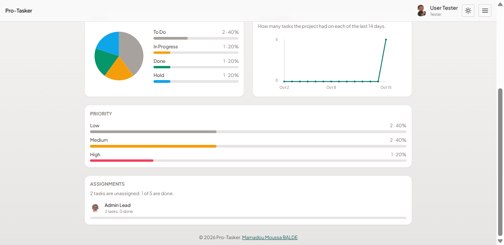

# Pro-Tasker

A shared project board. People register, create projects, invite collaborators, and move tasks across To Do, In Progress, Done, and Hold.

## Description

Pro-Tasker is a full-stack MERN application. The client is React. The API is Express and MongoDB. A JSON Web Token identifies the caller. Project and task routes then check whether that caller is the owner, an editor, or a viewer.

A person can create and share projects, assign tasks to the people a project was shared with, comment on a task, and open analytics for the selected project. The board supports search, filters, sort, due dates, priority, drag and drop, and light or night mode. The full handover record is `DOCUMENTATION.md`.

| Service | URL |
| --- | --- |
| Application | https://full-stack-mern-application-pro-tasker-1.onrender.com |
| API | https://full-stack-mern-application-pro-tasker.onrender.com |

| Layer | Tools |
| --- | --- |
| Frontend | React 19, TypeScript, Vite, React Router, Tailwind CSS, dnd-kit, Motion |
| Backend | Node.js, Express 5, Mongoose 9, JWT, bcrypt |
| Database | MongoDB |

## Screenshots

These pictures are signed in as User Tester (`user@demo.test`). Admin Lead (`admin@demo.test`) is the person the Product launch tasks are shared with.

### Dashboard


### Board


### Analytics




### Night mode


### Log in


### Create an account


## Getting Started

### Dependencies

* Node.js 20 or newer, and npm
* A MongoDB database the API can reach, such as MongoDB Atlas
* Two terminals, one for the API and one for the client
* Windows, macOS, or Linux

### Installing

Clone the repository and install each app from its own folder.

```bash
cd Backend
npm install
```

Create `Backend/.env`:

```env
PORT=3000
MONGO_URI=your-mongodb-connection-string
JWT_SECRET=your-secret
```

`PORT` defaults to `3001` when it is omitted. This project uses `3000` so it matches the client.

```bash
cd Frontend
npm install
```

Create `Frontend/.env`:

```env
VITE_API_URL=http://localhost:3000
VITE_TOKEN_KEY=pro-tasker-token
```

`Backend/.env` and `Frontend/.env` stay off the repository.

### Executing program

Start the API before the client.

```bash
cd Backend
npm run dev
```

`npm start` runs the API without nodemon. Confirm http://localhost:3000/. The body is `{ "message": "Pro-Tasker API is running." }`.

```bash
cd Frontend
npm run dev
```

Open the URL Vite prints, usually http://localhost:5173.

Load the sample boards after the API is running:

```bash
cd Backend
npm run sample
```

The command creates the two demo accounts when they are missing, then adds shared boards, tasks, comments, a closed project, and an archived project. Running it again skips anything already there.

| Full name | Username | Email | Password |
| --- | --- | --- | --- |
| User Tester | user | user@demo.test | user2026 |
| Admin Lead | admin | admin@demo.test | admin2026 |

Sign in as either account. User Tester owns Product launch. Admin Lead owns Website Redesign. Each person also sees the projects shared with them.

## Help

* `GET /api/projects` without a token returns 401. Sign in, then open `/dashboard`.
* The first request to the live API can take about a minute when the free service has been idle.
* If `user@demo.test` or `admin@demo.test` already exists with a different password, `npm run sample` stops and names that account.
* Routes: `/login` and `/register` are for guests. `/dashboard` is the board. `/analytics` and `/analytics/:projectId` are the analytics pages. Any other path redirects to `/dashboard`.
* The API reference, access rules, and deployment steps are in `DOCUMENTATION.md`.

## Authors

Mamadou Moussa BALDE

[@Mamadou Moussa BALDE](https://www.linkedin.com/in/2mb/)

## Version History

* 1.0
    * Initial delivery, 14 October 2026
    * Accounts, shared projects, task board, comments, analytics, and sample data
    * Source: https://github.com/baldemoussa/Full-Stack-MERN-Application-Pro-Tasker

## License

The backend `package.json` names the ISC license. This repository does not include a `LICENSE.md` file.

## Acknowledgments

* [React](https://react.dev/)
* [Express](https://expressjs.com/)
* [MongoDB](https://www.mongodb.com/)
* [Tailwind CSS](https://tailwindcss.com/)
* [dnd kit](https://dndkit.com/)
* [Render](https://render.com/)
* [README template](https://gist.github.com/DomPizzie/7a5ff55ffa9081f2de27c315f5018afc)
